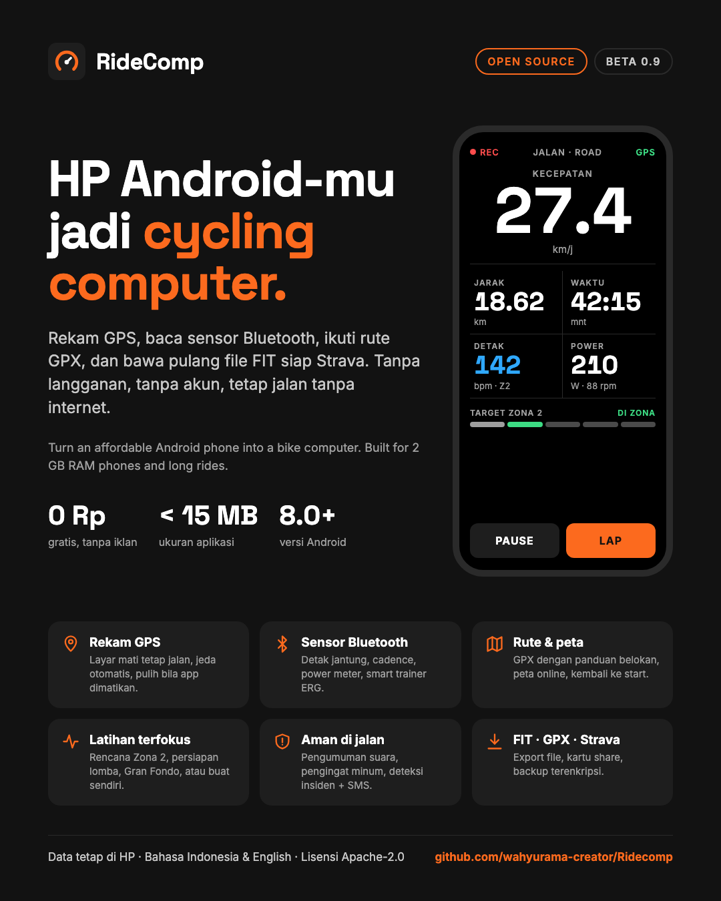

# RideComp


**RideComp turns an affordable Android phone into a bike computer, like a Garmin.** It records rides with GPS, reads Bluetooth sensors, guides you along GPX routes and makes FIT files ready for Strava. It is built for low-end phones (2–3 GB RAM), saves battery and works without internet.

> 🇮🇩 **Bahasa Indonesia** — RideComp mengubah HP Android murah menjadi *cycling computer*. Aplikasi tersedia dalam Bahasa Indonesia dan English. Panduan singkat berbahasa Indonesia ada di bagian [Panduan singkat (ID)](#panduan-singkat-id).

Status: **beta 0.9.0**, distributed as an APK on [GitHub Releases](../../releases) (not on the Play Store yet).

<p align="center">
  
</p>

## Features

| | |
|---|---|
| **Ride recording** | GPS keeps recording with the screen off. Auto-pause, laps, and recovery after the phone kills the app. |
| **Bluetooth sensors** | Heart rate, speed/cadence, power meter and **smart trainer (FTMS, ERG mode)**. |
| **Data pages** | Customisable data fields, activity profiles, **saved bikes** with component wear reminders. |
| **Navigation** | GPX routes with turn and climb guidance, an **online map** (OpenFreeMap) or a lightweight line view offline, and **back to start**. |
| **Training** | Records, segments, training load, **training plans** (Zone 2 base, race prep, Gran Fondo or your own) with target zones during the ride. |
| **Safety** | **Voice announcements**, drink/eat reminders, crash detection with an optional emergency SMS. |
| **Sharing** | FIT/GPX export, a share card, optional **Strava upload** and encrypted backups. |
| **Other** | Indonesian and English, and a **home screen widget**. |

## Installation (APK)

Requirements: **Android 8.0 or newer**. GPS is required; Bluetooth sensors are optional.

1. Open the [latest release](../../releases) on your phone and download one APK:
   - `RideComp-<version>-arm64-v8a.apk` fits almost every phone made since about 2017.
   - `RideComp-<version>-armeabi-v7a.apk` is for older 32-bit phones.

   Not sure which one? Pick **arm64-v8a**. If Android says *"App not compatible"*, use armeabi-v7a.
2. Open the downloaded file. If Android asks, allow **"Install unknown apps"** for your browser or file manager.
3. Tap **Install**. Later versions install over the old one and keep your data.

**Verify the download (optional):** compare the file against `SHA256SUMS.txt` from the same release:

```bash
sha256sum -c SHA256SUMS.txt --ignore-missing      # Linux
shasum -a 256 RideComp-*.apk                      # macOS
```

The release signing certificate fingerprint (SHA-256) is
`F4:E9:68:90:CE:4D:2A:BD:48:D5:4D:38:AB:33:85:0D:1F:AE:C4:3F:50:D9:AA:CE:C1:45:43:89:CB:FA:09:41`.
An APK signed with a different key is not an official build.

## Using RideComp

1. **First launch.** Choose a language and allow the permissions with **"Allow & continue"**. Location is required. Notifications, Bluetooth and physical activity are optional.
2. **Add your bike** (name, type, weight, wheel size). Add more bikes under **My bikes**, then pick one before each ride.
3. **Pair sensors (optional).** Go to **Sensors → Scan** and tap **Pair** next to your heart rate strap, speed/cadence sensor, power meter or smart trainer.
4. **Ride.** Tap **Start ride** on the **Ride** tab, then **Start**. Swipe between data pages, map and route. Recording keeps going with the screen off. **Pause** and **Lap** are always on screen. Tap **Finish** to save.
5. **Afterwards.** Open **History** for the activity, map, charts and records. Export a **FIT** or **GPX** file or upload to **Strava** (connect it in Settings).
6. **Routes.** Import a GPX file under **Routes**, then choose it before a ride to get turn guidance.
7. **Training.** Pick a plan from the **Training plan** card under **History → Training**. Today's session sets the target zone during the ride, and with a smart trainer it can also set ERG power.
8. **Widget.** Long-press the home screen, choose **Widgets → RideComp** to see today's session, your weekly total and a quick Start button.

Tip: some phones (Xiaomi, Oppo, Vivo, Samsung) stop apps in the background. If recording stops, set RideComp's battery mode to **"No restrictions"**. The app shows a reminder for this.

## Privacy

All data stays on your phone. There is no account, no analytics and no ads. The app goes online only for map tiles (when the online map is on), when you upload to Strava, and for a once-a-day update check on GitHub (can be turned off). See [docs/releases/PRIVACY.md](docs/releases/PRIVACY.md).

## Building from source

Requirements: **JDK 21**, Android SDK (API 37), and Android Studio or the command line.

```bash
git clone https://github.com/wahyurama-creator/Ridecomp.git
cd Ridecomp
./gradlew assembleDebug                       # app/build/outputs/apk/debug/
./gradlew ktlintCheck detekt lint test koverVerify   # the checks every change must pass
```

- **Release signing (optional).** A release build is signed only when a `keystore.properties` file exists in the project root. That file is git-ignored; never commit it or the keystore:
  ```properties
  storeFile=/absolute/path/to/your-release.jks
  storePassword=...
  keyAlias=...
  keyPassword=...
  ```
  Then run `./gradlew assembleRelease`. One APK is produced per ABI.
- **Strava (optional).** `gradle.properties` holds the public Client ID of the official app and the address of its token server. Neither is secret: the Client Secret lives only on the server ([server/strava-token-server](server/strava-token-server)). **If you publish your own fork**, create your own Strava API app and token server, then set `ridecomp.strava.clientId` and `ridecomp.strava.tokenServerUrl` to your values. Leave both empty to hide Strava.
- **Secret scan.** Run `git config core.hooksPath scripts/git-hooks` so every commit is checked for keys and passwords.

### Project layout

Clean Architecture with Kotlin and Jetpack Compose:

```
core/            domain: models, use cases, calculations (pure Kotlin)
data/            Room database, repositories, FIT/GPX
platform/        Android: GPS, BLE, foreground service, TTS, Keystore
ui-common/       design system and shared components
feature-*/       screens: ride, history, routes, sensors, training, settings
app/             wiring (Koin), navigation, widget
server/          Strava token server (Cloudflare Worker)
docs/            specs, rules, decisions, feature reports
```

The specifications and working rules live in [`docs/`](docs), grouped by folder (product, architecture, planning, rules, testing, releases, reports): see the map in [docs/README.md](docs/README.md). **New contributors start with [docs/STATUS.md](docs/STATUS.md)**: current status, the next task and setup. Agent rules: [CLAUDE.md](CLAUDE.md).

## Contributing

Issues and pull requests are welcome. Please:
- create one branch per change (`feature/<id>-<slug>` or `fix/<id>-<slug>`) and use [Conventional Commits](https://www.conventionalcommits.org/);
- make sure `./gradlew ktlintCheck detekt lint test koverVerify` passes;
- don't add a dependency without discussing it first, and never commit keys, tokens or ride data.

## Panduan singkat (ID)

**Instal:**
1. Buka [rilis terbaru](../../releases) di HP dan unduh **arm64-v8a** (untuk HP lama 32-bit, pilih **armeabi-v7a**).
2. Buka file APK, izinkan "Instal app tidak dikenal", lalu ketuk **Instal**. Pembaruan dipasang di atasnya dan data tetap aman.

**Pakai:**
1. Pilih bahasa, lalu ketuk **Izinkan & lanjut**.
2. Isi data sepeda.
3. Pasangkan sensor di menu **Sensor** (opsional).
4. Ketuk **Mulai** untuk merekam. Ketuk **Selesai** untuk menyimpan.
5. Lihat hasilnya di **Riwayat**. Dari sana Anda bisa export FIT/GPX atau upload ke Strava.

Bila rekaman berhenti sendiri, ubah mode baterai RideComp menjadi **"Tanpa batasan"**.

## License

[Apache License 2.0](LICENSE) © 2026 Wahyu Rama. Map data © OpenStreetMap contributors, tiles by OpenFreeMap.
